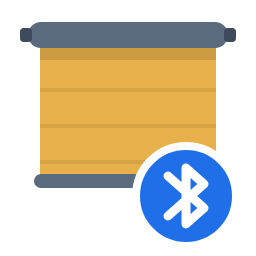

# Somfy Bluetooth for Home Assistant

[](https://github.com/6farer/ha-somfy-ble/releases/latest)
[](https://hacs.xyz/docs/faq/custom_repositories/)
[](LICENSE)



This Home Assistant integration is for Somfy Zigbee blinds paired directly to Home Assistant
through Zigbee2MQTT or ZHA. The integration connects to each motor over Bluetooth so you can
adjust its limits, direction, range, speed and soft start/stop, settings that Zigbee doesn't
expose and that Somfy's apps can only change through a TaHoma hub.

## Why use this

I built this because the limits on my Zigbee2MQTT blinds drifted over time, and Somfy's TaHoma
app can't reach blinds that aren't on a TaHoma hub. Since then I've also used it to set speeds
room by room, so the bedroom blinds open slowly at sunrise without waking me while the office
blinds move quickly when I want a fast adjustment.

Everything runs locally in Home Assistant through your Bluetooth adapter or an ESPHome proxy,
without a hub, a cloud service or a Somfy account.

> Built on [Melair's research](#credits).
> Writing limits or settings to a motor is at your own risk.

## Quick start

### Before you start

- [ ] **A supported motor.** A Somfy Sonesse Zigbee motor (see [Supported models](#supported-models)).
  It doesn't need to be paired to Zigbee or anything else; Bluetooth works either way.
- [ ] **Each motor's PIN.** 6 characters, 0–9 and A–F. It's on the motor's label, next to
  its EUI and Zigbee install code, which is hidden once the blind is mounted, so ask your
  installer for the list or note it down before installing.
- [ ] **Bluetooth that reaches the blinds.** Your Home Assistant's built-in adapter if it's
  close, otherwise a $5 ESP32 [Bluetooth proxy](docs/bluetooth-proxy.md) within a room or two.
- [ ] **Home Assistant 2026.7 or newer**, with [HACS](https://hacs.xyz/docs/use/) for the
  easiest install ([manual install](#manual-install-without-hacs) works too).

### Steps

1. **Install.** Click the button, then **Download**, then restart Home Assistant.

   [](https://my.home-assistant.io/redirect/hacs_repository/?owner=6farer&repository=ha-somfy-ble&category=integration)

   <sub>Without the button: HACS > ⋮ > Custom repositories, add
   `https://github.com/6farer/ha-somfy-ble` as an Integration, then download **Somfy
   Bluetooth**.</sub>

2. **Add your motors.** Home Assistant finds them on its own. Open
   [Settings > Devices & services](https://my.home-assistant.io/redirect/integrations/), and
   under **Discovered** click **Add** on each Somfy Bluetooth motor and type its PIN. Motors
   arrive named by the end of their Bluetooth address (e.g. `Somfy 3A:7F`); keep that name for
   now.

   Nothing discovered? See [Troubleshooting](#troubleshooting).

3. **Add the card.** Edit a dashboard, add a card, and pick **Somfy blind** (or paste
   `type: custom:somfy-blind-card`). The card comes with the integration, so there's nothing
   else to download.

4. **Name your blinds.** On the card, pick each motor and press **Identify**: that blind jogs
   briefly. Then rename it after the room with
   [Settings > Devices & services](https://my.home-assistant.io/redirect/integration/?domain=somfy_ble)
   > Somfy Bluetooth > the motor's ⋮ > **Reconfigure**, so `Somfy 3A:7F` becomes `Office Sheer`.
   A motor that jogs also proves its PIN and Bluetooth path work.

## What you get

Each motor becomes a device with:

| Platform      | Entities                                                                                                                                            |
| ------------- | --------------------------------------------------------------------------------------------------------------------------------------------------- |
| Button        | Identify, Stop, Jog up, Jog down, Set upper limit, Set lower limit, Start range, Set direction clockwise / counter-clockwise, Interrogate Bluetooth |
| Number        | Jog step (motor steps)                                                                                                                              |
| Sensor        | Status, Last result, Last error, Last command ID, Selected source, Last contact age                                                                 |
| Binary sensor | BLE reachable                                                                                                                                       |

Plus:

- **The Somfy blind card** (`custom:somfy-blind-card`): blind picker, Identify, Stop, jog,
  limits, range setup, direction, and an Advanced tab for motor speed and soft start/stop.
  It asks before saving a limit, changing direction or starting range setup.
- **`select.somfy_ble_selected_blind`**: one shared picker. Its `entities` attribute maps each
  function (`stop`, `jog_up`, …) to the selected motor's entity, so scripts and dashboards
  follow the selection without per-motor edits.
- **Actions**:
  - `somfy_ble.read_config` (`motor`) reads the motor's settings without changing anything,
    returning each value along with whether it's writable, its range, unit, default and choices.
  - `somfy_ble.write_config` (`motor`, `key`, `value`) writes one speed or ramp setting
    (`NominalSpeed`, `TiltSpeed`, `StartUpRamp`, `StartDownRamp`, `StopUpRamp`,
    `StopDownRamp`, `DisabledSoftRamps`, `DisabledSoftStartRamp`, `DisabledSoftStopRamp`). It
    needs a `read_config` of the same motor in the last 15 minutes, must stay within the
    reported range, and only counts as saved when a re-read confirms it.

The integration connects to a motor only when you send a command, moves Stop ahead of anything
else waiting, and closes the connection after 60 seconds without activity.

## Supported models

Bluetooth setup is only in Somfy's newer Zigbee motors. Older RTS-only motors have no
Bluetooth and won't work.

| Motor                                               | Status                              |
| --------------------------------------------------- | ----------------------------------- |
| Sonesse 28 WF Li-Ion Zigbee (reports as "Sonesse2") | ✅ Tested                            |
| Sonesse 30 WireFree Zigbee                          | ❔ Untested; same generation, likely |
| Sonesse 40 AC Zigbee (wired)                        | ❔ Untested                          |
| Sonesse RTS / WireFree RTS                          | ❌ No Bluetooth                      |

Home Assistant only discovers motors that advertise both Somfy's Bluetooth company ID and a name
starting with `Sonesse`. If yours shows up under another name in
[Settings > Bluetooth](https://my.home-assistant.io/redirect/bluetooth/) > **Advertisement
monitor**, you can still add it by hand; please
[open an issue](https://github.com/6farer/ha-somfy-ble/issues) with the model and what
worked, either way, so this table can grow.

Tested with ESPHome Bluetooth proxies on ESP32-S3 and ESP32-C3.

## Troubleshooting

- **Motor not discovered.** Check
  [Settings > Bluetooth](https://my.home-assistant.io/redirect/bluetooth/) >
  **Advertisement monitor** for devices named `Sonesse`. If none show up, no adapter or proxy
  can hear the motor; see [Bluetooth proxy](docs/bluetooth-proxy.md). If a motor shows there but isn't
  discovered, add it by hand:
  [Add integration](https://my.home-assistant.io/redirect/config_flow_start/?domain=somfy_ble)
  > **Somfy Bluetooth**, and copy its address from the monitor.
- **`auth_failed`.** Check the PIN. It's 6 characters of hex (0–9, A–F), even when it's all
  digits.
- **Commands time out.** The motor is too far from any proxy. In the advertisement monitor,
  aim for better than about −85 dBm; move or add a proxy.
- **Low battery.** Motors stop answering well before they're empty, so charge the motor and try
  again.

Change a motor's name, address or PIN later with **Reconfigure** on its entry.

## Safety

- The integration sends only the commands listed above and has no way to update firmware.
- Settings writes are limited to speed and ramp keys and checked against the range the motor
  reports.
- Each motor's address and PIN are stored in its config entry, like any integration's
  credentials (`/config/.storage/core.config_entries`, included in backups). Diagnostics
  downloads leave the PIN out. Change it with **Reconfigure**.

## Manual install (without HACS)

Copy `custom_components/somfy_ble/` from the
[latest release](https://github.com/6farer/ha-somfy-ble/releases/latest) to
`/config/custom_components/somfy_ble/` and restart Home Assistant. The card is included in that
folder.

## Development

```sh
python3.14 -m venv .venv
.venv/bin/pip install -r requirements_test.txt
.venv/bin/python -m pytest
node --test tests/somfy-blind-card.test.mjs
```

## Credits

The Bluetooth protocol this integration speaks was first documented by **Melair**
([mrmelair.com](https://mrmelair.com), [GitHub](https://github.com/melair)), who
reverse engineered Somfy's app to find the PIN authentication and motor commands. This
integration is built on the two write-ups below, and I couldn't have made it without them:

- [“Hacking” the Somfy Sonesse2 Zigbee Motors](https://mrmelair.com/2024/07/10/hacking-the-somfy-sonesse2-zigbee-motors/)
  (July 2024)
- [More BLE for the Somfy Sonesse2 Zigbee Motors](https://mrmelair.com/2024/08/22/more-ble-for-the-somfy-sonesse2-zigbee-motors/)
  (August 2024)

## License

[MIT](LICENSE)
